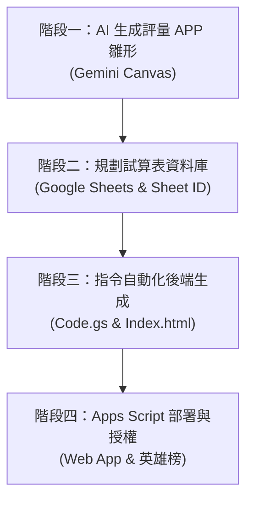

# 115 國中數學領域 數位科技推動自主學習探究 (AI × APP × GAS)

> **中央課程與教學輔導諮詢教師 ｜ 桃園市數學輔導團中興國中 李慧玲老師 主講**  
> 專案結合 **生成式 AI (Gemini Canvas)**、**自主學習評量 APP** 與 **Google 雲端試算表 (Google Apps Script, GAS)**，打造零成本、免 API Key 的即時智慧教學評量與學習歷程追蹤系統。

🌐 **線上互動分類查詢系統**：[https://yaoshuchin.github.io/1151123-math-ai-app-gas/](https://yaoshuchin.github.io/1151123-math-ai-app-gas/)  
🔑 **系統存取密碼**：`049`  
📌 **Padlet 協作牆原網址**：[https://reurl.cc/NOKz9k](https://reurl.cc/NOKz9k)

---

## 🌟 專案成果亮點

1. **📌 Padlet 研習協作板完整移植（含 29 張原始圖片與作品連結）**
   - 完整收錄「115南投縣素養研習_Apps Script部署」Padlet 5 大專欄（講義、互動式評量、部署、成果_互動式評量、成果_部署）共 31 則貼文。
   - 所有圖片與截圖已全部下載至專案 `assets/padlet/` 實體存放並上傳 GitHub，支援點擊 Lightbox 高清大圖檢視。
   - 彙整各校（福豐、建國、經國、慈文、中興、青溪、會稽、大有、宏仁、魚池）教師設計之互動評量 APP 連結（Gemini Canvas 與 GAS 正式網址），可一鍵點擊直連試玩。
   - 提供李慧玲老師分享之 `Code.gs` 與 `Index.html` 雲端備份 Google 文件直連。

2. **📄 講義重構與 Word 輸出 (`.docx`)**
   - 完整辨識研習 PDF 36 頁投影片內容，結構化編排並匯出為好閱讀、可編輯的繁體中文 Word 文件：`115國中數學領域數位科技推動自主學習探究.docx`（已追加第九章 Padlet 31 項成果與各校教師作品表）。

3. **💻 互動式分類查詢網頁系統 (`index.html`)**
   - **專用密碼保護**：系統預設存取密碼為 `049`（支援虛擬九宮格數字鍵盤與鍵盤輸入）。
   - **雙重檢視模式**：支援「Padlet 原汁原味橫向滾動看板 (Kanban)」與「網格卡片視圖 (Grid)」隨時切換。
   - **全 36 頁投影片步驟索引**：支援 8 大階段分類切換與全書查詢。
   - **即時全文跨庫搜尋與高亮**：同時搜尋投影片教材與 Padlet 各校貼文（如學校名稱、畢氏定理、二次函數、Sheet ID、Code.gs 等）。
   - **一鍵複製核心提示詞 (Prompt)**：內建評量活動生成指令與 GAS 自動化串接指令一鍵複製。
   - **🎮 國中數學互動評量試玩 Demo**：內建「一元一次方程式」三關卡測驗、KaTeX 數學公式即時渲染、手寫塗鴉計算紙與隨機去識別化代碼英雄榜。

4. **🚀 雲端發布至 GitHub & GitHub Pages**
   - 線上即刻存取與分享！全靜態離線可用！

---

## 🔑 系統存取密碼

進入線上查詢網頁時，請輸入通關密碼：
```text
049
```

---

## 📘 四大實作階段簡介



### 1. 評量活動 APP 提示詞規範
- **基本資料**：學生輸入班級、座號、姓名。
- **階梯式三關卡**：基礎關 (5 題) → 進階關 (3 題) → 挑戰關 (2 題)，每題 10 分，合計 100 分。
- **手寫計算紙**：每題提供點選展開畫布，隨手演算。
- **公式渲染**：採用 KaTeX 或 MathJax，數學符號優雅美觀。
- **重做機制**：第二次作答時動態抽題，題目難度一致但數值不同。

### 2. GAS 後端指令架構亮點
- **零點擊初次執行（Zero-Click）**：透過 `getInitialData()` 函數自動偵測並建立「成績紀錄」分頁與模擬資料，完全不需要手動進入編輯器按執行。
- **同座號重複測驗標註**：跳出提醒視窗，確認後於次列標記 `⚠修改分數`，完整保留歷程。
- **去識別化即時英雄榜**：使用隨機代碼（如 `T01A9K`）呈現即時得分排名，保護學生隱私。
- **本地端離線防呆降級**：自動處理非 GAS 環境中 `google is not defined` 報錯，支援本地即時測試。

### 3. Apps Script 部署三大關鍵提醒
> [!IMPORTANT]
> 1. **Index 檔名大小寫**：新增 HTML 檔案名稱務必為 `Index`，首字母「I」必須大寫！  
> 2. **執行身分**：部署時「執行身分」務必選擇「**我**」。  
> 3. **存取權限**：部署時「誰可以存取」務必選擇「**所有人**」（Anyone）。

---

## 📂 檔案目錄架構

```text
├── 115國中數學領域數位科技推動自主學習探究.pdf    # 原始研習教材簡報 (36 Slides)
├── 115國中數學領域數位科技推動自主學習探究.docx    # 辨識重新排版輸出之 Word 完整手冊
├── index.html                                      # 互動分類查詢網頁系統 (密碼: 049)
├── build_word_doc.js                               # Word 自動化產生腳本 (Node.js + docx)
└── README.md                                       # 專案說明文件
```

---

*本專案由 AI 輔助系統依據 115 國中數學領域數位科技推動自主學習探究研習內容重編建置。*
